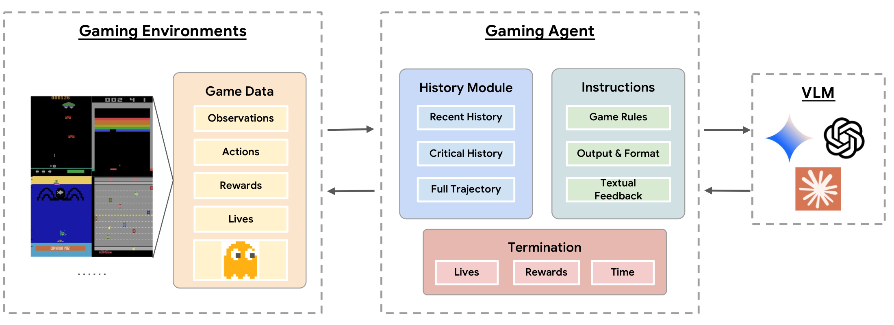

<div align="center">
  <h1>AtariBench</h1>
</div>

<p align="center">
  <a href="https://mignonjia.github.io/AtariBench/"><b>Website</b></a> |
  <a href="docs/neurips_2026.pdf"><b>Paper · NeurIPS 2026</b></a> |
  <a href="https://mignonjia.github.io/AtariBench/"><b>Leaderboard</b></a> |
  <a href="https://github.com/mignonjia/AtariBench"><b>Code</b></a>
</p>

AtariBench evaluates whether multimodal language models can act, not just describe: models must perceive high-FPS Atari gameplay, follow game-specific prompts, emit joystick actions, and optimize reward in a closed loop. Our experiments focus on spatiotemporal understanding and sequential decision-making, finding that current VLMs often recognize objects but still struggle with motion direction, visual grounding, and step-to-step action choices.

<p align="center">
  
</p>

## Repository Structure

```text
AtariBench/
├── config/                 # Batch configs and shared defaults
├── src/ataribench/         # Installable runtime package
│   ├── main.py             # ataribench-run
│   ├── batch_run.py        # ataribench-batch
│   ├── core/               # Environment loop and trajectory recording
│   ├── games/              # Game registry, prompts, and ALE helpers
│   ├── llm/                # Provider adapters and thinking-mode resolution
│   └── viz/                # Video rendering
├── tests/                  # Focused regression tests
└── docs/                   # GitHub Pages website and documentation
```

Root-level `main.py` and `batch_run.py` are compatibility wrappers for the package entrypoints. For a more detailed source map, see [`docs/repo_index.md`](docs/repo_index.md).

## Setup

Create or update the `ale` conda environment from [`environment.yaml`](environment.yaml), then export the provider keys you need:

```bash
conda env create -f environment.yaml
conda activate ale
python -m pip install -e .
```

This installs the Python dependencies plus the `ffmpeg` binary used for video rendering.

```bash
conda activate ale
export GEMINI_API_KEY="YOUR_GEMINI_KEY"
export OPENAI_API_KEY="YOUR_OPENAI_KEY"
export ANTHROPIC_API_KEY="YOUR_ANTHROPIC_KEY"
export TOGETHER_API_KEY="YOUR_TOGETHER_KEY"
```

## Main Command

The main workflow is config-driven batch mode.

- [`config/common.yaml`](config/common.yaml): shared defaults such as game selections, incomplete-run retries, concurrency caps, duration, and rendering settings
- [`config/runs.yaml`](config/runs.yaml): the full set of batch run definitions
- [`config/debug.yaml`](config/debug.yaml): a smaller debug batch

Some params:

- `games` can be a single game key, `full` (all 20 games), or a list mixing those values.
- Allowed `thinking_mode` values are model-specific; see [`src/ataribench/llm/model_thinking.json`](src/ataribench/llm/model_thinking.json).
- Per-setting `max_actions_per_turn` controls the prompt, parser, and execution cap (1--10 actions).
- Per-setting `text_feedback_mode` selects the standard event feedback (`full`) or removes textual reward, life-loss, and reset notices while retaining visual history (`none`).
- Together-hosted models such as `deepseek-ai/DeepSeek-V3.1` can be used directly as `--model` values; slash-form model names resolve to the Together adapter, and DeepSeek V3.1 supports `thinking_mode: off` and `thinking_mode: on`.

For a quick debug run, use `debug.yaml`. If you want even faster debug cycles, lower `duration_seconds` in [`config/common.yaml`](config/common.yaml).
Gameplay is time-budgeted; life loss consumes time but is not a separate runner termination rule.

Run the debug batch with:

```bash
ataribench-batch --common-config config/common.yaml --runs-config config/debug.yaml
```

Use [`config/runs.yaml`](config/runs.yaml) instead of `debug.yaml` when you want the full batch.

Optional minimal logging:

```bash
ataribench-batch --common-config config/common.yaml --runs-config config/debug.yaml --minimal-logging
```

This keeps only `summary.json`, `turns.jsonl`, and `visualization.mp4` in each run directory after rendering.


## Other Commands

Single run:

```bash
ataribench-run \
  --game breakout \
  --model gemini-2.5-flash \
  --thinking off \
  --prompt-mode structured_history \
  --duration-seconds 30
```

Credential-free smoke run:

```bash
ataribench-run --game breakout --model random --duration-seconds 1 --seed 0
```

## Important Options

- `--duration-seconds`: total game budget
- `--prompt-mode`: `structured_history` or `append_only`
- `--text-feedback-mode`: `full` or `none`
- `--context-cache`: enable explicit cache hints for `append_only`; `structured_history` remains unchanged
- `--minimal-logging`: after rendering, keep only `summary.json`, `turns.jsonl`, and `visualization.mp4`
- `max_concurrency_by_company`: config-driven per-company concurrency caps in `common.yaml`
- `max_retries`: config-driven incomplete-run retry count in `common.yaml`
- `retry_backoff_seconds`: config-driven incomplete-run retry backoff base in `common.yaml`
- `render_video_fps`: config-driven visualization FPS in `common.yaml`
- `max_actions_per_turn`: config-driven action-chunk cap from 1 through 10
- `text_feedback_mode`: config-driven textual outcome-feedback treatment (`full` or `none`)

Transient provider errors such as `429 RESOURCE_EXHAUSTED`, network timeouts, and empty provider responses are retried inside the active turn by the LLM adapter. Batch-level reruns are reserved for incomplete runs that exited cleanly without reaching the full frame budget.

## Output

Successful runs are written under `runs/<game>/<model>/`. Each completed run stores `turns.jsonl`, `summary.json`, `visualization.mp4`, and, unless minimal logging is enabled, frame/prompt/response artifacts.

For the full run directory layout, summary files, and batch metadata format, see [`docs/logging/README.md`](docs/logging/README.md).

## Batch Logging

Each batch writes a `batch_summary.json` describing that batch, while canonical model summaries are refreshed from stored successful runs. Details are documented in [`docs/logging/README.md`](docs/logging/README.md).

## Prompt Design

Each game has a prompt module under [`src/ataribench/games/prompts/`](src/ataribench/games/prompts/) with its action vocabulary, task framing, and action-planning guidelines. Shared prompt assembly lives in [`src/ataribench/games/prompt_builder.py`](src/ataribench/games/prompt_builder.py).

AtariBench currently supports two prompt modes:

- `structured_history`: sends the current frame plus curated recent clips and non-zero-reward clips. This is the default benchmark prompt mode.
- `append_only`: sends the interaction as a chronological user/assistant transcript. This mode can attach explicit context-cache hints for providers that support them.

At serving time, `append_only` is sent as structured chat messages, not hand-written role tags. Prompt artifacts are saved for inspection in each run directory under `prompts/`, including text and HTML views.

## Thinking Modes

Thinking support is model-specific.

- The allowed modes per model live in [`src/ataribench/llm/model_thinking.json`](src/ataribench/llm/model_thinking.json).
- The effective resolved request settings come from [`src/ataribench/llm/common.py`](src/ataribench/llm/common.py) via `describe_effective_thinking_mode()`.
- `thinking_mode` is the requested user-facing knob.
- `thinking_level` and `thinking_budget` are the resolved provider-specific settings recorded in summaries.
- `input_tokens`, `output_tokens`, `total_tokens`, `thinking_tokens`, and `cached_input_tokens` are recorded for cost estimation when the provider reports them.

## Cite Our Work

```bibtex
@inproceedings{huo2026ataribench,
  title = {Evaluating Spatiotemporal Reasoning of Vision-Language Models in Atari Gameplay},
  author = {Huo, Mingjia and Fu, Yao and Chang, Bo and Wang, Yaqing and Zhu, Dawei and Zhang, Dylan and Yi, Xinyang and Hong, Lichan and Chi, Ed H. and Zhang, Hao and Tang, Jiaxi},
  booktitle = {The Fortieth Annual Conference on Neural Information Processing Systems Evaluations and Datasets Track},
  year = {2026}
}
```
